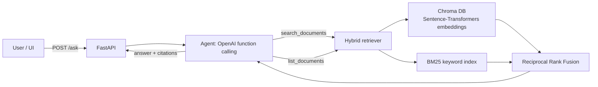

# Agentic RAG Document Q&A

Ask questions about your own documents and get answers grounded in the text, with the supporting passages shown. An LLM agent uses **function calling** to decide how to search (whole library, one specific document, or list what's available), retrieval is **hybrid** (dense vectors + BM25 + metadata filters), and a **retrieval-evaluation harness** measures precision, recall and groundedness so retrieval changes are judged on numbers, not vibes.

**Live demo:** `http://<your-ec2-ip>/` · **API docs:** `http://<your-ec2-ip>/docs`

## Architecture



## Features

- **Agentic tool use** – the model chooses between `search_documents` (with an optional `source` filter) and `list_documents`, and can call tools several times before answering. Answers cite chunks inline as `[file#chunk]`.
- **Hybrid retrieval** – cosine similarity over `all-MiniLM-L6-v2` embeddings in Chroma, plus a from-scratch Okapi BM25 index, combined with Reciprocal Rank Fusion. Fusing ranks rather than raw scores avoids having to calibrate BM25 scores against cosine similarities.
- **Metadata filtering** – restrict any search to one document (`source`), applied in both the vector store and the BM25 index.
- **Evaluation harness** – `eval/run_eval.py` compares vector, BM25 and hybrid retrieval on a labelled question set (precision@k, recall@k, hit rate, MRR) and scores generated answers for groundedness. CI fails if hybrid recall drops below 0.9.
- **Works without an API key** – with no `OPENAI_API_KEY`, the service falls back to an extractive answer built from the top-ranked sentences, so the demo and tests run offline.
- **Production setup** – Docker image with the embedding model baked in, persistent Chroma volume, health check, GitHub Actions CI (lint, tests, eval, image build) and CD to AWS EC2.

## Evaluation results

Run on the 14-question labelled set in `eval/eval_set.jsonl` (k = 3):

```bash
python -m eval.run_eval --answers
```

| Strategy | Precision@3 | Recall@3 | Hit rate | MRR |
|----------|-------------|----------|----------|-----|
| Vector   | _fill in_   |          |          |     |
| BM25     |             |          |          |     |
| Hybrid   |             |          |          |     |

Answer groundedness: _fill in_

> Fill this table in from your own run with the real embedding model, and add more questions to `eval_set.jsonl` as you add documents.

## Run locally

```bash
python -m venv .venv && source .venv/bin/activate      # Windows: .venv\Scripts\activate
pip install -r requirements.txt
cp .env.example .env                                     # add OPENAI_API_KEY for LLM answers
export $(grep -v '^#' .env | xargs)                      # or set the variables another way
export CHROMA_DIR=./chroma_data
uvicorn app.main:app --reload
```

Open http://localhost:8000 for the UI or http://localhost:8000/docs for the interactive API. Three sample policy documents (a fictional company) load on first start so there is something to ask about straight away.

### Tests

```bash
pip install -r requirements-dev.txt
pytest -q
```

Tests use a hashing embedder and an in-memory vector store, so they run in seconds with no model download or API calls.

## API

| Method | Path | Purpose |
|--------|------|---------|
| `POST` | `/ask` | `{"question": "...", "source": "optional.md"}` → answer, sources, tool calls |
| `POST` | `/search` | `{"query": "...", "strategy": "hybrid|vector|bm25", "k": 5, "source": null}` |
| `GET` | `/documents` | List documents and chunk counts |
| `POST` | `/documents` | Upload a `.md`, `.txt` or `.pdf` (multipart field `file`) |
| `DELETE` | `/documents/{source}` | Remove a document |
| `GET` | `/health` | Status, document count, whether the LLM is enabled |

## Deploy to AWS EC2

1. **Launch an instance** – Ubuntu 22.04+, `t3.small` or larger (the embedding model needs ~1 GB RAM), 20 GB disk. In the security group allow SSH (22) from your IP and HTTP (80) from anywhere.
2. **Install Docker on the instance:**
   ```bash
   sudo apt update && sudo apt install -y docker.io docker-compose-v2 git
   sudo usermod -aG docker $USER && newgrp docker
   ```
3. **Clone and configure:**
   ```bash
   git clone https://github.com/<your-username>/agentic-rag-doc-qa.git ~/agentic-rag-doc-qa
   cd ~/agentic-rag-doc-qa && cp .env.example .env && nano .env   # add your OPENAI_API_KEY
   docker compose up -d --build
   ```
4. **Turn on continuous deployment** – in GitHub → Settings → Secrets and variables → Actions, add `EC2_HOST`, `EC2_USER` (`ubuntu`) and `EC2_SSH_KEY` (the full `.pem` contents). Every push to `main` that passes CI now redeploys automatically.

Tip: give the instance an Elastic IP so the demo link doesn't change when it restarts.

## Project structure

```
app/
  main.py          FastAPI routes
  agent.py         function-calling agent + extractive fallback
  retrieval.py     hybrid retriever, RRF, metadata filters
  bm25.py          Okapi BM25 + tokeniser
  embeddings.py    Sentence-Transformers / hashing embedders
  vectorstore.py   Chroma and in-memory stores
  chunking.py      section-aware overlapping chunks
  static/index.html
eval/              labelled questions + evaluation harness
tests/             unit, API and retrieval-quality tests
.github/workflows/ CI and EC2 deployment
```

## Ideas for next steps

Cross-encoder re-ranking of the fused results, LLM-as-judge groundedness scoring, streaming responses, and per-user document collections.
